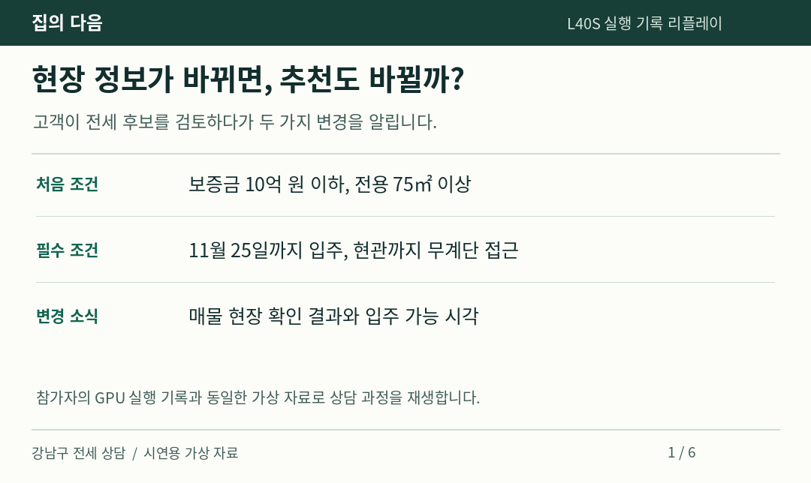

# 집의 다음 · GPU 실행 로그 재생

실제 상담 화면은 [원본 시연 영상 · 1분 2초](https://drive.google.com/file/d/1glDUGIpctpFEOYttOO61-2cBdNl9vSQZ/view)에서 볼 수 있습니다. 아래의 32초 영상은 실행 로그를 카드로 재구성한 요약본입니다.

**[후보 검색부터 시작](01-search.md)** · [현장 재검증](02-inspection.md) · [입주 지연](03-schedule.md)

2026년 11월 19일 L40S에서 실행한 세 상담의 도구 기록을 차례로 열어볼 수 있습니다. 당시 사용한 가상 매물과 업체 시간표를 앱에 다시 넣어 후보 수와 일정 대안도 함께 표시했습니다. GPU를 끈 뒤에도 이 페이지에서 확인할 수 있습니다.

[일시 정지할 수 있는 MP4 영상](track1-replay.mp4) · [실행 로그 3종](../README.md) · [발표용 데모 QR](demo-qr.png) · [앱 실행 방법](../../README.md)
